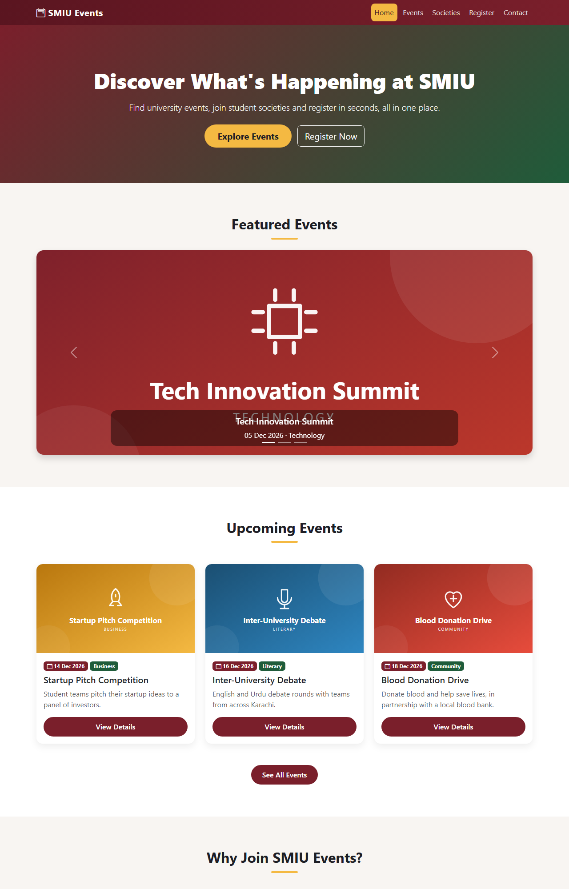

# SMIU Events Portal

A modern, mobile-friendly front-end website for the Student Affairs Office of Sindh Madressatul
Islam University (SMIU). Students can discover university events, explore student societies and
register for events.

Built with **HTML5**, **Bootstrap 5.3.3** (CDN), **Bootstrap Icons** and a custom stylesheet.

## Group Members

| Name | Roll No. | GitHub | Pages built |
|------|----------|--------|-------------|
| Hunain Saeed | BSE-24S-050 | [hunain0408-cloud](https://github.com/hunain0408-cloud) | Repository setup, navbar, footer, `index.html` |
| Ubaid Ullah | BSE-24S-023 | [ashad133](https://github.com/ashad133) | `events.html`, `event-details.html` |
| Tasmia Mehmood | SFS-24S-002 | [tasmia84-collab](https://github.com/tasmia84-collab) | `societies.html`, `register.html`, `contact.html`, README |

## Pages

| Page | Description |
|------|-------------|
| `index.html` | Home: hero with call-to-action, featured events carousel, upcoming events, "Why Join" section |
| `events.html` | Responsive grid of 8 event cards and a striped, hoverable schedule table |
| `event-details.html` | Event banner, information list, accordion (Schedule / Speakers / Rules) and a registration modal |
| `societies.html` | Admissions alert and 6 society cards with member-count badges |
| `register.html` | Full event registration form (two columns on desktop, one on phone) |
| `contact.html` | Contact form, office details, map placeholder and "Meet the Team" |

## Screenshots

**Home page on desktop**



**Home page on phone**


## How to Run

1. Clone the repository:
   ```
   git clone https://github.com/hunain0408-cloud/smiu-events-portal-alpha.git
   ```
2. Open the folder and double-click `index.html` to open it in a web browser.
   An internet connection is needed because Bootstrap and Bootstrap Icons load from a CDN.
3. (Optional) In VS Code, right-click `index.html` and choose "Open with Live Server".

## Project Structure

```
index.html  events.html  event-details.html  societies.html  register.html  contact.html
css/style.css     custom theme (CSS variables) and component styles
images/           original SVG artwork made by the team
screenshots/      screenshots used in this README
```
